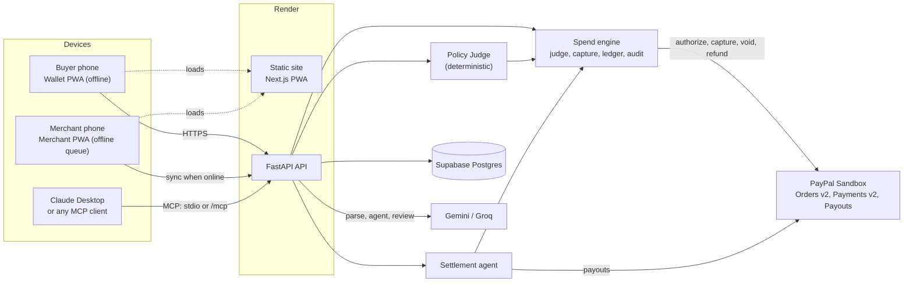
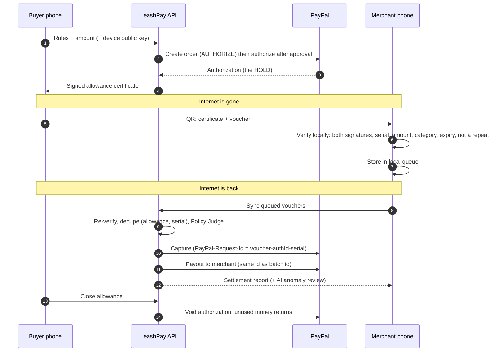

# LeashPay

**Your money, on a leash.**
A PayPal wallet where you write the spending rules in plain English and a deterministic Policy Judge enforces them, for an AI shopping agent, for any other AI agent you bring, and for offline Show-to-Pay vouchers that work with zero internet.

- **Live demo:** https://leashpay-krgp.onrender.com (API: https://leashpay-api.onrender.com, first request may take 30-60 s to wake)
- **3-minute video:** VIDEO_URL_HERE
- **Judges:** a 5-minute guided path with only a laptop browser is in [docs/JUDGES.md](docs/JUDGES.md)
- PayPal **Sandbox** only, USD. Built for the PayPal AI Hackathon.

**Contents:** [Problem](#the-problem) · [What it does](#what-leashpay-does) · [How PayPal is used](#how-paypal-is-used) · [How AI is used](#how-ai-is-used) · [Architecture](#architecture) · [Offline security](#offline-security-model) · [Tools](#built-with) · [Try it](#try-it-in-5-minutes) · [Run locally](#run-locally) · [MCP](#bring-your-own-agent-mcp) · [Tests](#tests) · [Limitations](#limitations-and-honest-notes)

## The problem

**Nobody trusts an AI agent with their wallet.** Agents can now shop for us, but handing one a card number means handing over everything. A prompt that says "be careful" is not a spending limit, and a model that can approve its own purchases is not a control.

**Digital payments die when the network dies.** Festivals, flights, basements, rural markets and crowded stadiums are exactly where cards and wallets fail, because every payment needs a live server to say yes. Cash works there; apps don't.

## What LeashPay does

You write rules once ("food and rides only, max $20 per purchase, no alcohol, ask me above $10, offline taps up to $5") and put money on hold. After that there is **one engine and three ways to spend**, all guarded by the **same Policy Judge**:

| Way to spend | Who decides what to buy | Who decides if it is allowed |
|---|---|---|
| **AI shopping agent** (`/agent`) | Our chat agent searches a demo store and proposes a cart | Policy Judge: PASS captures, NEEDS_APPROVAL waits for you, FAIL is blocked with a plain-English reason |
| **Offline Show-to-Pay** (`/wallet`, `/merchant`) | You, at a stall, with no signal | The merchant phone verifies a signed voucher locally; the server judges again at settlement |
| **Bring your own agent** (MCP) | Claude Desktop or any MCP client, using a key you create | The same Policy Judge, plus an optional per-purchase cap per agent key |

The money is a PayPal **authorization hold**, not a transfer. Every spend is a partial capture of that hold, every decision is written to an audit log, and closing the allowance releases whatever is left.

## How PayPal is used

All PayPal calls live in one file, [`backend/app/paypal.py`](backend/app/paypal.py). Sandbox, USD.

| PayPal API | What we do with it | Why it matters |
|---|---|---|
| **Orders v2**, `POST /v2/checkout/orders` with `intent: AUTHORIZE` | Create the allowance as an order for the full amount | The buyer approves **once**; money is held, not taken |
| `POST /v2/checkout/orders/{id}/authorize` | Turn the approved order into an authorization | Gives us the `authorization_id` that every later spend draws from |
| **Partial captures**, `POST /v2/payments/authorizations/{id}/capture` (`final_capture` false / true) | Each approved purchase or settled voucher captures only its amount | One hold funds many small payments; `final_capture: true` ends it cleanly |
| `POST /v2/payments/authorizations/{id}/void` | Close the allowance | The unused part returns to the buyer immediately |
| `GET /v2/payments/authorizations/{id}` | Check status and remaining amount | Keeps our numbers honest against PayPal's |
| **Refunds**, `POST /v2/payments/captures/{id}/refund` | "Return the chips" | Refunds go back to the buyer's PayPal balance (they do not re-fill the hold, and the UI says so) |
| **Payouts v1**, `POST /v1/payments/payouts` | Pay the merchant after an offline voucher settles | The seller gets paid by PayPal, not by us |
| **`PayPal-Request-Id`** on every money-moving POST | Idempotency | Retries can never double-charge |

**The core trick: the hold *is* the offline guarantee.** Because the full amount is already reserved at PayPal, a merchant who accepts a voucher offline knows the money exists. The wallet can only issue `max_vouchers = floor(amount / per_tap_max)` vouchers, so total offline exposure can never exceed the hold. At sync time each voucher's capture uses `PayPal-Request-Id: voucher-{authorization_id}-{serial}` (the same string is the payout `sender_batch_id`), so **PayPal itself refuses a double charge** even if our server retried, crashed mid-way or received the same voucher twice.

## How AI is used

| Where | What the model does | Guardrail |
|---|---|---|
| **Rules to policy JSON** (`/policy/parse`) | Turns plain English into the Policy JSON schema and **reports ambiguities** ("No daily limit given; assumed $60") so you confirm before any money is held | Output is schema-validated; you approve the parsed card |
| **Shopping agent** (`/agent`) | **One structured-JSON call per turn** decides intent (search, buy, refund, status) and picks items | Prices come only from the database; the cart goes through the Policy Judge |
| **Settlement anomaly review** | After a batch of offline vouchers settles, reviews it for odd patterns (e.g. many vouchers at one merchant in minutes) and rates the risk | Advisory only: it never changes a decision |
| **Category classification** | Classifies an unknown item or merchant into a category | The result feeds the rules; the rules decide |

Providers: **Gemini** (`gemini-3.5-flash-lite`) with automatic **Groq** fallback (`openai/gpt-oss-120b`) on rate limits or errors. All LLM code is in [`backend/app/llm.py`](backend/app/llm.py).

**Design rule: the deterministic judge decides; the LLM never approves money.** The Policy Judge ([`backend/app/policy/judge.py`](backend/app/policy/judge.py)) is plain code: same input, same verdict, with reasons ordered as rule violations, then limits, then allowance remaining. A confused or manipulated model can ask for a purchase; it cannot make one happen.

## Architecture



**Offline flow:**



## Offline security model

In plain English, and without a server in the loop at the moment of payment:

- **Device key.** When you create an allowance your phone generates an Ed25519 keypair. The private key never leaves the device (IndexedDB); only the public key goes to the server.
- **Server-signed certificate.** The server signs a certificate binding your public key to the rules that matter offline: per-tap max, max vouchers, allowed and blocked categories, expiry. The merchant app caches the server's public key and can check that signature with no network.
- **Signed vouchers.** Each tap is a numbered voucher signed by your device key. The merchant checks both signatures, that the serial is within `max_vouchers`, that the amount is at most the per-tap cap, that the merchant's category isn't blocked, that it has not expired and that the serial isn't already in its queue.
- **Exposure is bounded by the hold.** `max_vouchers = floor(amount / per_tap_max)`, so even if every voucher is spent, the total cannot exceed what PayPal is holding.
- **Replay protection.** The server enforces `UNIQUE(allowance, serial)`, and PayPal enforces the capture `PayPal-Request-Id`. A re-sync of an already settled voucher is acknowledged ("Already settled earlier"), not charged again; a different merchant or amount for the same serial is rejected.
- **Known limitation.** A screenshot of a QR could be shown to two merchants. The server accepts the first to sync and rejects the second, and the loss is bounded by the per-tap cap.

## Built with

**Sponsor tools**
- **Render**: the API runs as a web service and the frontend as a free static site, both defined in one Blueprint ([`render.yaml`](render.yaml), guide in [docs/DEPLOY.md](docs/DEPLOY.md)).
- **AG Grid Community**: the `/dashboard` audit log, vouchers and purchases grids.

**Other tools:** Supabase (Postgres) · Next.js PWA with Serwist (offline service worker) · Tailwind · FastAPI · SQLModel · PyNaCl and `@noble/ed25519` · `html5-qrcode` / `qrcode.react` · MCP Python SDK · Gemini and Groq · **Claude Code**, used to build it, task by task from [CLAUDE.md](CLAUDE.md).

## Try it in 5 minutes

Use https://leashpay-krgp.onrender.com with the PayPal sandbox buyer from the Devpost testing instructions. The full click path, including the one-laptop offline demo, is in **[docs/JUDGES.md](docs/JUDGES.md)**. The short version:

1. `/setup`: pick an example chip, **Understand my rules**, **Create allowance**, approve on PayPal.
2. `/agent`: "snacks for movie night" (PASS), "a beer" (BLOCKED), "return the chips" (refund).
3. `/wallet` then **Show to Pay**; `/merchant` scans and charges with the network off; back online it syncs and pays out.
4. `/dashboard`: every decision, with reasons.

## Run locally

Needs Python 3.11+ and Node 22.

**PayPal sandbox:** at [developer.paypal.com](https://developer.paypal.com) create a Sandbox REST app and copy its client id and secret. In Sandbox accounts use **US** accounts: a Business account (the merchant payout email) and a Personal account (the buyer you approve with). Currency is USD.

**Backend**
```bash
cd backend
python -m venv venv && venv\Scripts\activate      # macOS/Linux: source venv/bin/activate
pip install -r requirements.txt
cp .env.example .env                               # fill in the values below
uvicorn app.main:app --reload --port 8000
```

**Frontend**
```bash
cd frontend
npm ci
echo NEXT_PUBLIC_API_URL=http://localhost:8000 > .env.local
npm run dev                                         # http://localhost:3000 (service worker is off in dev)
# production-like, with offline support:
npm run build && npx serve out
```

| Variable (`backend/.env`) | Purpose |
|---|---|
| `PAYPAL_CLIENT_ID`, `PAYPAL_CLIENT_SECRET`, `PAYPAL_BASE_URL` | Sandbox REST app (`https://api-m.sandbox.paypal.com`) |
| `MERCHANT_PAYOUT_EMAIL` | Sandbox business account that receives all demo merchant payouts |
| `DATABASE_URL` | `sqlite:///./leashpay.db` locally; Supabase session-pooler URI in production |
| `LLM_PROVIDER`, `LLM_FALLBACK`, `GEMINI_API_KEY`, `GROQ_API_KEY`, `GEMINI_MODEL`, `GROQ_MODEL` | Gemini primary, Groq fallback |
| `SERVER_SIGNING_KEY` | Ed25519 seed (`python scripts/gen_signing_key.py`); required when `APP_ENV=production` |
| `FRONTEND_URL`, `CORS_ORIGINS` | Where PayPal returns the buyer; browser origins allowed to call the API |
| `APP_ENV` | `development` or `production` |

Frontend: `NEXT_PUBLIC_API_URL` (build-time). Never commit real values; `.env.example` lists every key.

## Bring your own agent (MCP)

LeashPay is also a leash for *other people's* AI agents. Create an agent key in the wallet (**AI agents on your leash**), point Claude Desktop (or any MCP client) at `mcp_server/server.py` or at the remote `/mcp` endpoint, and the agent can search, buy, check and refund, while the Policy Judge still enforces every cent. It can never change your rules, approve its own purchases or close the allowance. Setup, the Claude Desktop config for Windows and security notes: [docs/MCP.md](docs/MCP.md).

## Tests

```bash
cd backend && python -m pytest -q          # 183 tests: judge, crypto, settlement dedupe, spend, API, agents, deploy
python -m pytest mcp_server -q             # 6 tests (run from repo root, inside the mcp_server venv)
cd frontend && npm test                    # 24 tests: canonical JSON, compact QR format, offline verify
cd frontend && npm run build               # static export to frontend/out/
```

PayPal is faked in tests; `backend/scripts/smoke_paypal.py`, `smoke_allowance.py` and `simulate_offline.py` exercise the real sandbox.

## Limitations and honest notes

- **Sandbox only, USD only.** No real money moves.
- **No user login.** It is a single-demo-user app. Owner actions (authorize, approve/deny, close, agent keys) are protected by an **owner token** created with the allowance, shown once and stored only on the creating device. Lose the device, lose owner control (the hold still expires).
- **Demo store only.** The shopping agent searches our seeded catalog (5 merchants, about 20 products), not the real internet.
- **Refunds go to the buyer's PayPal balance**, not back onto the hold, so "Left on hold" never grows after a refund. The UI reports refunds separately.
- **Late sync window.** A voucher issued before its certificate expired can settle later while the allowance is open; PayPal honors an authorization for about 29 days. Closing early forfeits vouchers not yet synced (the API warns first).
- **QR screenshot replay** is bounded, not eliminated (see Offline security).
- The free Render API sleeps when idle; the first request can take 30-60 s.

More notes on vouchers and closing: [CLAUDE.md](CLAUDE.md) (full spec), [docs/DEPLOY.md](docs/DEPLOY.md).

## License

MIT, see [LICENSE](LICENSE).
